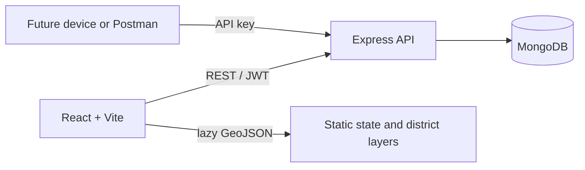

# VB-G RAM G

A Phase 1 rural-development work monitoring portal. The React/Vite client uses an Express/Mongoose REST API, JWT-protected roles, work and field-update records, CSV import/export, dashboard summaries, manual district zero-work reports, and a Leaflet choropleth backed by lazily loaded GeoJSON. IoT hardware is not part of this release.

## Architecture



## Stack

- React 19, Vite 8, CSS, Leaflet / OpenStreetMap, Recharts
- Node.js, Express 4, JSON REST APIs, Mongoose 8
- JWT authentication, bcrypt password hashing, admin/officer/viewer roles, Helmet headers, and per-process auth/write rate limits
- geoBoundaries state/district layers; third-party redistributed data, not government-verified

## Hosted deployment (Render / separate frontend host)

- Deploy `backend` as a Node web service with Root Directory `backend`, Build Command `npm install`, and Start Command `npm start`.
- Configure backend environment variables: `MONGODB_URI`, `JWT_SECRET` (at least 32 random characters), `FIELD_DEVICE_API_KEY`, and `CLIENT_ORIGIN` (the exact deployed frontend origin). The MongoDB database used by this app is `vb_gram_g`.
- In MongoDB Atlas, confirm the database user/password are correct, URL-encode reserved characters in the password, and configure Network Access to allow connections from the backend host. A code change cannot bypass Atlas authentication or network-access rules.
- Set `VITE_API_BASE_URL` in the frontend host to the backend origin, for example `https://your-api.onrender.com`, then rebuild/redeploy the frontend. This is a build-time Vite variable; do not put MongoDB credentials in the frontend.
- Verify the backend at `https://YOUR-BACKEND/api/health`. A healthy response is `{"status":"ok","database":"connected"}`. A `503` means the API is running but MongoDB is not connected; inspect backend logs for the underlying Atlas/DNS/authentication error.

## Local setup

1. Install a supported Node.js release and have a MongoDB database available.
2. Copy `backend/.env.example` to `backend/.env`.
3. Set `MONGODB_URI`, a private `JWT_SECRET` (at least 32 characters), a separate `FIELD_DEVICE_API_KEY`, and the exact `CLIENT_ORIGIN`. Never commit `.env`.
4. In `backend`, run `npm install`.
5. In `frontend`, run `npm install`.
6. In one terminal, run `cd backend; npm run dev`.
7. In another terminal, run `cd frontend; npm run dev`.
8. Open `http://localhost:5173`; create the initial admin with the `ADMIN_*` values and `cd backend; npm run create-admin` if the database is empty.

The frontend proxies `/api` to `http://localhost:53184`; change the proxy in `frontend/vite.config.js` if the API port is changed.

## Environment variables

| Variable | Purpose |
|---|---|
| `PORT` | API port (default `53184`) |
| `MONGODB_URI` | Main MongoDB connection string; never use for automated destructive tests |
| `MONGODB_URI_TEST` | Separate disposable database used only by database-backed integration tests; must not resolve to the main database |
| `MONGODB_DNS_SERVER` | Optional resolver IP for MongoDB SRV lookup |
| `CLIENT_ORIGIN` | Comma-separated exact allowed browser origins |
| `TRUST_PROXY` | Set to `1` only behind exactly one trusted reverse proxy |
| `JWT_SECRET` | Private signing secret, at least 32 characters |
| `FIELD_DEVICE_API_KEY` | Separate private API key for field updates |
| `ADMIN_NAME`, `ADMIN_EMAIL`, `ADMIN_PASSWORD` | Optional initial admin account values |
| `DEMO_ACCOUNT_PASSWORD` | Required demo-seed password shared by demo-only accounts (12–128 characters) |

The `.env.example` includes a local test-database placeholder. The current test suite is unit/API focused; database-backed integration coverage is not configured. Never point tests at the main database.

## Data commands and tests

- Backend tests: `cd backend; npm test`
- Frontend tests: `cd frontend; npm test`
- Frontend lint: `cd frontend; npm run lint`
- Production frontend build: `cd frontend; npm run build`
- Geo validation/processing: `cd backend; npm run validate-geo` and `npm run process-geo`
- Catalogue validation is dry-run only: `cd backend; npm run validate-catalogue -- <catalogue.csv>`
- Set `DEMO_ACCOUNT_PASSWORD` (12–128 characters) in `backend/.env`, configure `MONGODB_URI` to a disposable database with `demo` or `test` in its database name, then run `cd backend; npm run seed-demo`. The `npm run seed` alias also invokes this safe seed. It inserts 180 synthetic works across state/district names present in the pinned boundary file, all four sample categories and lifecycle statuses, plus field-update history. Every seeded work has `isDemo: true`. The seed never upserts or modifies work records; reruns require `npm run clear-demo` first.
- Demo seeding refuses database names without `demo` or `test`; `--force-demo` explicitly bypasses this guard. Use the override only after confirming the target is disposable. It also aborts if any reserved demo account email already exists.
- Run `cd backend; npm run clear-demo` to remove only tagged demo works, field updates/audits attached to those work IDs, and users with `isDemo: true`. It has the same database-name guard.
- Demo-only login emails are `admin.demo@vbgramg.invalid`, `officer.demo@vbgramg.invalid`, and `viewer.demo@vbgramg.invalid`. All use the configured `DEMO_ACCOUNT_PASSWORD`; the password is not printed by the command. Do not reuse it in production.
- The dashboard/map/registry toggle includes or hides demo records; included records are visibly labeled. API works, locations, summary and export exclude demo records by default; `includeDemo=true` includes them.
- Work records created or updated through the API record the responsible user and timestamps. Successful deletes write a separate audit event. Older records may not have actor data.

## API overview

| Endpoint | Purpose |
|---|---|
| `GET /api/health` | API/database health |
| `POST /api/auth/register`, `POST /api/auth/login` | Viewer registration and login |
| `GET/POST /api/auth/users`, `PATCH /api/auth/users/:id` | Admin user management |
| `GET /api/categories` | Work category catalogue |
| `GET/POST /api/works`, `GET/PATCH/DELETE /api/works/:id` | Work registry |
| `GET /api/works/locations` | Location strings already used by works |
| `POST /api/works/import`, `GET /api/works/export.csv` | CSV import/export |
| `POST /api/field-updates` | API-key-protected field update |
| `GET /api/field-updates` | Authenticated field-update history |
| `GET /api/dashboard/summary` | Filtered dashboard and geography metrics |
| `POST /api/reporting-coverage` | Admin/officer manual district zero-work report |

Reporting coverage is an immutable manual district declaration for an exact date range, not an official feed. Matching non-demo works prevent a zero report; demo works do not.

## Project layout

```text
backend/                 Express API, models, routes, tests, seed and geo scripts
frontend/src/             React entry, portal, choropleth and styles
frontend/public/data/geo/  Lazily fetched state and district GeoJSON
data/geo/raw/              Preserved source boundary data and provenance
data/geo/                  Processed boundary layers and source notes
docs/                      Data mapping and project documentation
```

## Known limitations

The pinned layers contain 36 state/UT polygons and 735 district polygons; the source metadata reports 736, while the LGD portal displays 784 districts. These third-party boundaries may be simplified, outdated, or disputed. There are no verified block/Gram Panchayat boundaries or LGD join codes, and the official 318-work catalogue remains blocked. Demo records, block/GP labels and coordinates are synthetic; do not present them as actual reporting. Hardware is not integrated. Work records only represent areas entered/imported into the database. See [project status](docs/PROJECT_STATUS.md) and [source mapping](docs/data-source-mapping.md).

Pre-existing works from the former sample seed are deliberately left untouched and are not tagged `isDemo`; review them before presenting the registry as production data.

# vg-
